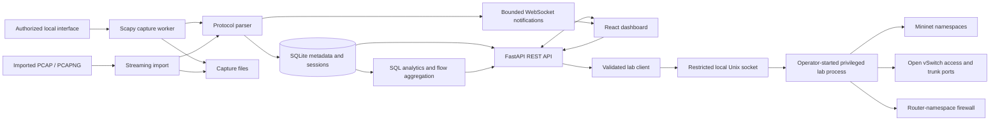
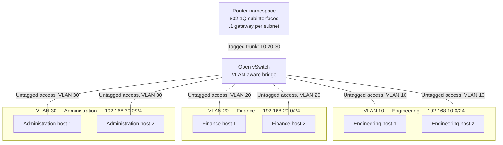

# Architecture

NetScope has two independent data paths: packet analysis and an optional Linux VLAN lab. The browser never captures packets itself, and drawing a topology does not create a network.

## Packet data path

1. A capture session records its origin, interface or imported filename, filter, state, timestamps, and counts. An imported file remains labelled as imported traffic.
2. Scapy dissects packets from a background capture worker or an uploaded capture file. Missing layers are normal: an ARP frame has no TCP ports, and a loopback packet may have no meaningful Ethernet address.
3. A structured packet record stores available layer fields, captured length, timestamp, endpoints, protocol classification, direction, and VLAN information. Packet metadata is persisted; capture files supply exportable packet bytes separately.
4. Filtering and pagination query persisted packet records. Analytics derive from the selected session's records rather than a synthetic dashboard feed.
5. The browser receives live notifications over WebSockets and refreshes REST aggregates. REST remains the source of truth after reconnects; a disconnected or slow browser must not stop capture.

Protocol classification is a presentation label, while flow grouping uses the transport protocol where possible. For example, a TCP flow carrying DNS should not become unrelated flows merely because a later packet has no decodable DNS body. Application identification by standard ports is a heuristic, not proof of the application in use.

## Lab data path

The optional lab is created only by an explicit operator command on a compatible Linux machine. Its privileged process owns the Mininet network and exposes a small validated command vocabulary over a local Unix socket. The HTTP server does not offer arbitrary shell execution.

The API can show desired VLAN definitions while the lab is absent. Desired configuration, applied configuration, and observed connectivity are distinct states. A failed ping establishes lack of reachability for that test; it does not, by itself, identify an ACL as the cause.

The two hosts in a VLAN share a broadcast domain. A host sends off-subnet traffic to its `.1` gateway. IP forwarding is initially disabled in the router namespace. Enabling routing permits a route to be used; the forwarding firewall still decides which traffic is admitted. The host machine's general forwarding and firewall settings are outside this lab's scope.

## Trust boundaries and operational constraints

- Bind development services to loopback. The application is a single-operator local tool, not an authenticated multi-tenant monitoring server.
- Packet capture needs operating-system permission and explicit authorization for the interface being monitored. PCAP import works without live capture permission.
- The lab process needs elevated Linux privileges. Give its socket only to the intended local operator; anyone with access to that socket can affect the lab.
- Traffic metadata and capture files can contain sensitive information. Keep the data directory private and delete captures according to the operator's retention requirements.
- The dashboard does not decrypt TLS. Addresses, ports, sizes, timing, and some handshake metadata may be visible; encrypted application content is not presented as readable plaintext.
- A namespace is an isolation tool, not a hardened security boundary against a privileged or compromised host administrator. Run the lab in a dedicated VM when appropriate.

## Resource model

Packet rows, session metadata, network configuration, and test history survive backend restarts in SQLite. Live WebSocket delivery is transient. Capture files are stored separately to avoid placing full packet payloads into every database row.

Capture limits and import limits bound individual operations. Operators remain responsible for total disk usage across retained sessions. Analytics are designed for a local educational project; sustained high-rate production capture, distributed collection, full TCP stream reassembly, and an intrusion-detection engine are outside scope.
